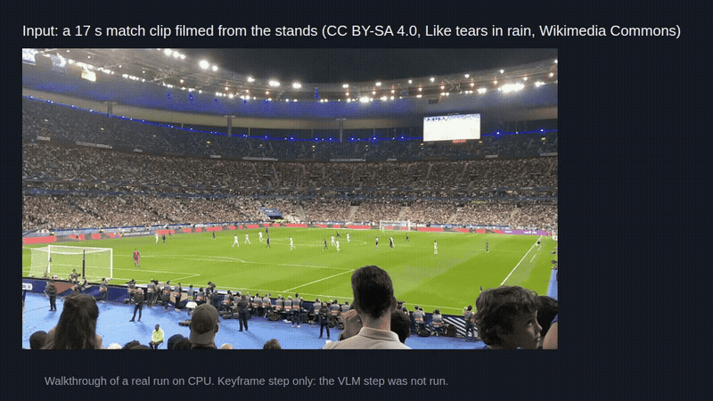

# soccer-vision-research



Soccer video experiments: keyframes for a vision model, plus a draft player recognition package.

```bash
git clone https://github.com/jayhemnani9910/soccer-vision-research && pip install -r soccer-vision-research/yt/requirements.txt
```

Project page: https://jayhemnani9910.github.io/soccer-vision-research/ (a rendered copy of this README).

## Usage

The YouTube tool in `yt/`:

```bash
cd soccer-vision-research/yt
export VLM_BACKEND=qwen2vl            # or openai, with OPENAI_API_KEY set
python analyze_youtube_vlm.py "https://www.youtube.com/watch?v=VIDEO_ID"
python query_video.py scenes          # list what it stored
python query_video.py objects "ball" --limit 5
```

Settings it reads are in `yt/.env.example`. More in `yt/README.md`.

I have not run the full pipeline end to end. The demo above is the keyframe step only, run on CPU.

## How it works

`yt/analyze_youtube_vlm.py`:

1. Downloads the video with yt-dlp.
2. Picks keyframes with OpenCV. The default `content-diff` method saves a frame when at least 5% of pixels change by more than 25 grey levels. `hist-threshold` compares HSV histograms instead. Either way it forces a frame if nothing was picked for 15 s.
3. Sends each keyframe to a vision-language model (Qwen2-VL-2B locally, or an OpenAI model) with a scanner prompt, a tracker prompt (skipped on the first frame) and a Q&A prompt, each asked to return JSON.
4. Writes frames, objects, events and Q&A to SQLite at `vlm_outputs/video_analytics.db`, and scene summaries to `vlm_outputs/scene_narratives.jsonl`.

`yt/query_video.py` searches that database by object, text, event type or scene.

On the 17 s clip in the demo, `content-diff` saved 140 keyframes in about 10 s, because the camera pans. `hist-threshold` saved 2.

## The player recognition package

`package/soccer_player_recognition/` is a package for detection, segmentation, identification and classification of players. It is mostly scaffolding: many modules, demos and docs, no trained weights. The RF-DETR and SAM2 classes are hand-written PyTorch models with untrained heads, not the official releases.

What runs, checked with Python 3.11 and PyTorch 2.15 on a laptop with an 8 GB GPU:

- The package imports, and `PlayerRecognizer(enable_all_models=False)` constructs.
- `complete_system_demo`, `model_management_demo`, `real_time_demo` and `resnet_demo` run headless to the end. `benchmark_demo` and `single_model_demo` were still running after 3 minutes, so I stopped them. `rf_detr_demo` needs `--input <image>`. `sam2_demo` crashes in `models/segmentation/sam2_model.py`: the input frame stays on the CPU while the model is on the GPU.
- The test suite collects 97 tests: 35 pass, 62 fail. On CPU-only CI (`pip install -e`, which also pulls ultralytics) it is 23 pass, 73 fail, 1 skipped. Most failures are tests written against APIs the code does not have (`ImageUtils`, `DrawUtils`, `register_model(config=...)`).

Toy or simulated parts:

- `simple_youtube_processor.py`, `process_youtube_video.py`, `standalone_complete_demo.py`, `standalone_single_demo.py` and most scripts under `demos/` use random or synthetic data in place of model output. Their boxes and numbers are not real detections.
- Any accuracy or FPS a demo prints comes from that demo data.

`package/soccer_player_recognition/README.md`, `DEMO_README.md` and `CONFIG_README.md` describe the intended design. Read them as plans, not as working features.

To run the tests:

```bash
python -m venv .venv && source .venv/bin/activate
pip install -e package/soccer_player_recognition pytest psutil
cd package/soccer_player_recognition
python -m pytest tests -q -p no:cacheprovider
```

## Contributing

See [CONTRIBUTING.md](CONTRIBUTING.md).

## License

Copyright (C) 2026 Jay Hemnani. Licensed under the [GNU AGPL v3.0](LICENSE), because the package depends on [Ultralytics](https://github.com/ultralytics/ultralytics), which is AGPL-3.0.

## Credits

The demo GIF uses frames from "Match de football France-Allemagne - 16 octobre 2018 - Phase de jeu (1)" by Like tears in rain, [Wikimedia Commons](https://commons.wikimedia.org/wiki/File:Match_de_football_France-Allemagne_-_16_octobre_2018_-_Phase_de_jeu_(1).ogv), CC BY-SA 4.0. The GIF is shared under the same license.
